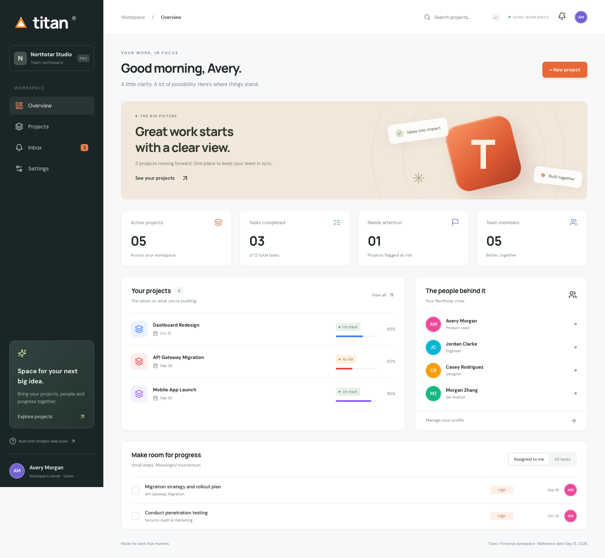

# Titan Web App

### Your work, in focus.

A polished, customer-facing workspace for projects, people and progress. Titan pairs a warm orange-and-sage visual identity with an approachable React + TypeScript codebase: real interactions, deterministic fictional data, explicit business rules and automated tests.



## Take a look around

- **Overview:** project health, calculated metrics, team roster and interactive task completion.
- **Projects:** text search, status filters, empty states and a validated create-project dialog.
- **Inbox:** read individual updates or clear the unread count across navigation and reloads.
- **Settings:** edit your profile, notification preferences, timezone and light/dark/system appearance.
- **Local persistence:** versioned, validated browser state with a safe fallback for corrupted or blocked storage.
- **Responsive layout:** desktop sidebar, compact mobile navigation, keyboard focus and reduced-motion support.
- **Searchable architecture:** feature modules, domain policies, schemas, fixtures, unit tests, browser tests, ADR and example engineering tickets.

> Titan is a fictional demo, not a production service. There is no authentication, backend, email delivery, analytics or real customer data. Never enter secrets or personal data. Notification timestamps follow your timezone; task due dates are calendar dates evaluated against the fixed demo reference date, 15 September 2026.

## Run locally

Requires **Node.js 22.12+** and npm. From your downloaded or cloned repository:

```bash
npm ci
npm run dev
```

Open **http://localhost:5173**. No credentials, environment variables or database setup required.

```bash
npm run build       # Type-check and build dist/
npm run preview     # Serve the production build locally
npm run check       # ESLint, TypeScript, production build and unit tests
npm run test:watch  # Interactive unit tests
npm run format      # Consistent source formatting
```

### Browser tests

```bash
npx playwright install chromium
npm run test:e2e
```

Playwright starts its own server on port 4173. Test coverage includes task persistence, inbox bulk-read, project creation/search, profile and theme persistence, corrupted state, mobile navigation and route errors. See [testing](docs/testing.md).

## Repository map

```text
src/
  app/                  # Workspace state, validation and mutation boundary
  components/           # Shared visual primitives and date formatting
  data/                 # Deterministic fictional fixtures
  domain/               # Types, input schemas and pure business policies
  features/
    dashboard/          # Overview and task completion
    projects/           # Search, status filtering and create dialog
    notifications/      # Read state and unread filtering
    settings/           # Profile, timezone, theme and reset
  lib/                  # Browser-safe persistence
  App.tsx               # Routes and responsive application shell
  main.tsx              # React entry point
  index.css             # Design tokens and responsive styles
 tests/e2e/             # User journeys in a real browser
 docs/                  # Architecture, decisions and engineering scenarios
 .github/workflows/     # Reproducible CI checks
```

## A code-search demo that makes sense

Give an engineer a small ticket, then ask them to locate the user journey, mutation, policy, fixture and tests before changing code. Start with [engineering scenarios](docs/demo-scenarios.md).

Example: **“The inbox badge needs a mark-all-read action that works across pages.”**

A good contextual answer should connect `NotificationsPage` → `useApp().readAll` → `markAllRead` / `unreadCount` → `App` navigation → persistence and regression tests. The existing behavior is implemented; the document also includes clearly labelled future enhancements, not deliberately planted bugs.

## Stack

React 19 · TypeScript · Vite · React Router · Zod · Lucide icons · Vitest · Playwright · ESLint · Prettier.

## Product rules worth knowing

- Completing a task updates task counts, but does **not** change a project's manually curated progress percentage.
- Project search and status filters are page-local; project creation and workspace changes persist across reloads.
- Notification preferences are saved demo settings, not a working notification delivery service.
- Reset restores only Titan's versioned workspace key, not unrelated browser storage.
- Date-only due dates intentionally do not shift when the timezone preference changes.
- Google Fonts supplies optional typography; system-font fallbacks keep the app usable offline. No external API provides demo data.

## GitHub handoff

The source is ready to upload to a new GitHub repository. Include the lockfile, source, documentation, public assets and tests; exclude `node_modules`, `dist`, local environment files and test output. Git is initialized locally but no commits or remote are created by the scaffold.

For a static host, configure all application routes to serve `index.html` (BrowserRouter history fallback). Subdirectory hosting also needs Vite `base`, router basename and asset-path configuration. The default build targets a domain root.

## Further reading

- [Architecture and code map](docs/architecture.md)
- [Engineering demo scenarios](docs/demo-scenarios.md)
- [Local state ADR](docs/adr/001-local-demo-state.md)
- [Security boundary](docs/security.md)
- [Tests and verification](docs/testing.md)
- [Contributing](CONTRIBUTING.md)
- [Domain API reference](DOMAIN_LAYER.md)
